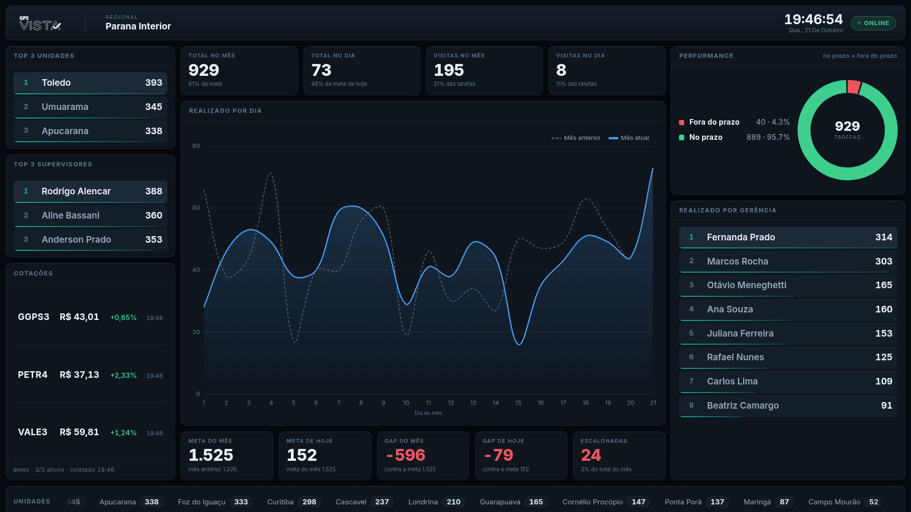

# Vista View

**Dashboard operacional do GPS Vista — painel 16:9 para TV, atualizado em tempo real.**


Projeto desenvolvido para o **GPS Group** como camada de visualização sobre os dados do
warehouse do GPS Vista. A tela principal é feita para ficar ligada em uma TV de gerência:
números tabulares, cores semânticas, um único selo Online/Offline e atualização empurrada
pelo servidor por Socket.IO — a página nunca recarrega.

Acompanha, por recorte de cadeia de comando (`GER`/`GR`/`DIR`):

- totais de tarefas e visitas, do dia e do mês;
- meta, gap e escalonadas;
- realizado por dia com comparação entre mês anterior e mês corrente;
- desempenho no prazo / fora do prazo e rankings de unidades e supervisores;
- cotações de até cinco ativos da B3.




*Screenshot do modo demonstração (`MODO_DEMO=true`): os números e nomes são sintéticos.*

## Início rápido

```bash
git clone https://github.com/foxtec198/VistaVIew.git
cd VistaVIew
python -m venv venv && source venv/bin/activate   # Windows: venv\Scripts\activate
pip install -r requirements.txt -r requirements-dev.txt
cp .env.example .env
python -m services.semente                        # popula o espelho SQLite local
python app.py                                     # http://localhost:8092
```

Para desenvolvimento com dados sintéticos, sem banco e sem API:
`MODO_DEMO=true python app.py`. Em produção, `python wsgi.py` sobe o servidor Socket.IO e
inicia os ciclos em segundo plano (painel e cotações), encerrando-os de forma ordenada em
`SIGINT`/`SIGTERM`.

## Modos

| Modo | Ativação | Dados |
| ---- | -------- | ----- |
| Demonstração | `MODO_DEMO=true` | sintéticos determinísticos; nenhum acesso a banco ou provedor |
| Desenvolvimento | padrão | ORM sobre SQLite local (`python -m services.semente`) |
| Warehouse | `DB_URI=mssql+pyodbc://…` | ORM sobre SQL Server (`dw_vista`, leitura com `WITH(NOLOCK)`) |

A fonte dos indicadores é escolhida uma vez, na criação da aplicação, e é a mesma para as
rotas HTTP e para o Socket.IO. Dado real e de demonstração não se misturam.

## Configuração

As variáveis estão em [`.env.example`](.env.example); mínimos e validação em
[docs/configuracao.md](docs/configuracao.md). As três do primeiro uso:

| Variável | Para quê |
| -------- | -------- |
| `MODO_DEMO` | painel com dados sintéticos, sem banco nem API |
| `DB_URI` | URI SQLAlchemy do warehouse; ausente, o painel lê do SQLite local |
| `ACTION_API` | token da brapi.dev para as cotações (opcional: sem ele a faixa mostra `—`) |

## Tecnologia

Python · Flask · SQLAlchemy 2 via Flask-SQLAlchemy (ORM portável entre SQL Server e SQLite) ·
Gevent · Flask-SocketIO · Chart.js · pytest. As faixas de versão aceitas estão em
[`requirements.txt`](requirements.txt).

## Testes

```bash
python -m pytest -q
```

231 testes, sem nenhuma saída de rede: contrato de cada rota, filtros de negócio na consulta
compilada, janelas de data, portabilidade entre os dois bancos, diff do tempo real, isolamento
do modo demo, limites das cotações, layout do painel e os critérios anti-regressão da
auditoria.

## Documentação

| Documento | Conteúdo |
| --------- | -------- |
| [docs/arquitetura.md](docs/arquitetura.md) | camadas, modelos, portabilidade, rotas e eventos |
| [docs/configuracao.md](docs/configuracao.md) | cada variável de ambiente e os três modos |
| [CONTRIBUTING.md](CONTRIBUTING.md) | ambiente, convenções de código, testes, PR |
| [SECURITY.md](SECURITY.md) | itens sensíveis, proteções, superfície exposta, como reportar |
| [docs/auditoria-e-baseline.md](docs/auditoria-e-baseline.md) | estado anterior e critérios de aceitação |
| [docs/decisoes-tecnicas.md](docs/decisoes-tecnicas.md) | por que cada decisão foi tomada |
| [docs/modo-demo.md](docs/modo-demo.md) | demonstração, isolamento e auditoria do Showcase |
| [docs/cotacoes.md](docs/cotacoes.md) | comparação de provedores e o que foi validado |

## Segurança

`.env` nunca vai para o repositório, o token do provedor não aparece em resposta HTTP nem em
log, o recorte é uma whitelist que devolve coluna mapeada — não texto — e os modelos são
espelho de leitura, sem caminho de escrita para o warehouse. Modelo de ameaça, garantias
cobertas por teste e canal de reporte em [SECURITY.md](SECURITY.md).

## Licença

MIT.
